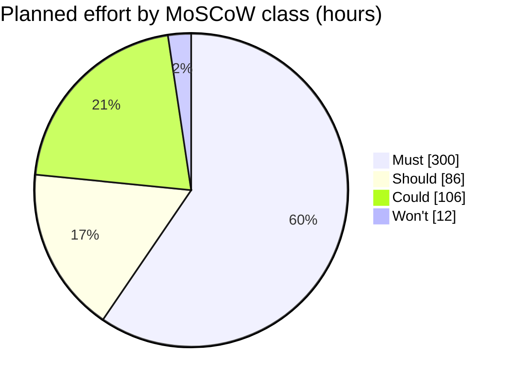

# MoSCoW rating for the week-14 pilot · Realtime Quiz

Test order: Must = pilot cancelled without it; Should = painful but a
workaround exists; Could = nice to have; Won't = not in this pilot.

| Id  | Feature                           | Plan   | Mine   | h  | Justification |
|-----|-----------------------------------|--------|--------|----|---------------|
| F01 | Create quizzes with MCQ           | Must   | Must   | 44 | Must: without quizzes there is nothing to run, so the pilot is cancelled. No workaround. |
| F02 | Students participate in real time | Must   | Must   | 52 | Must: live participation is the purpose of the pilot with 50 students. No workaround. |
| F03 | Instant feedback and scoring      | Must   | Must   | 28 | Must: students must see right or wrong and a score; marking by hand defeats a real-time quiz. |
| F04 | Leaderboards                      | Must   | Must   | 24 | Must: the pilot goal is live competition; a shared live ranking has no workaround. |
| F05 | Real-time updates over WebSocket  | Must   | Must   | 48 | Must: the broadcast-under-500-ms target cannot be met without it, so the pilot fails its quality floor. |
| F06 | Authentication and roles          | Must   | Must   | 44 | Must: instructors and students need separate rights and 50 named accounts; an open system is unacceptable. |
| F07 | Timer per question                | Must   | Must   | 28 | Must: timed questions are the quiz format; a manual clock is unfair and cannot be synchronised. |
| F08 | Multiple concurrent sessions      | Must   | Must   | 32 | Must: the pilot runs several groups at once; one session at a time cannot serve 50 students. |
| F09 | Responsive design                 | Should | Should | 20 | Should: painful on phones, but pilot students can use laptops. Workaround exists. |
| F10 | Analytics and reporting           | Should | Should | 30 | Should: instructors can read scores from the leaderboard and a database export for one pilot. Workaround exists. |
| F11 | Export results to CSV and PDF     | Should | Should | 24 | Should: instructors can open the CSV in a spreadsheet; PDF is cosmetic for a pilot. Workaround exists. |
| F12 | Real-time notifications           | Should | Should | 12 | Should: the instructor can announce events in the room; notifications are convenient, not essential. |
| F13 | Multimedia in questions           | Should | Could  | 24 | Could: pilot quizzes are text-only (agreed with two instructors); images can follow in release 1.1. |
| F14 | Chat during sessions              | Could  | Could  | 40 | Could: nice to have; students can ask questions in the room, so it is the first to drop. |
| F15 | Anonymous joining with nickname   | Could  | Could  | 12 | Could: pilot students log in with the 50 accounts from F06, so guests are not needed. |
| F16 | Question bank shared between quizzes | Could | Could | 30 | Could: instructors can copy questions between quizzes by hand for one pilot. |
| F17 | Admin role and user management    | Could  | Won't  | 12 | Won't: the PM manages the 50 pilot accounts by SQL script, so no admin screen is needed for one pilot. |

## Totals
| Class  | Features | Hours | Share of 504 h |
|--------|----------|-------|----------------|
| Must   | 8        | 300   | 59.5 %         |
| Should | 4        | 86    | 17.1 %         |
| Could  | 4        | 106   | 21.0 %         |
| Won't  | 1        | 12    | 2.4 %          |
| Total  | 17       | 504   | 100.0 %        |

Must share = 300 h / 504 h x 100 = 59.5 %  (guideline: 60 % or less, inside the guideline)

